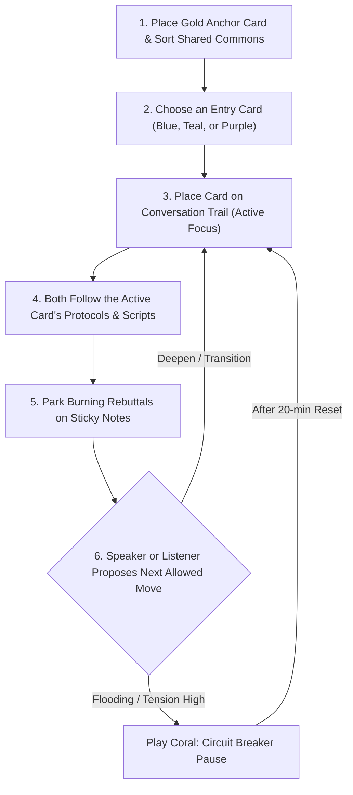
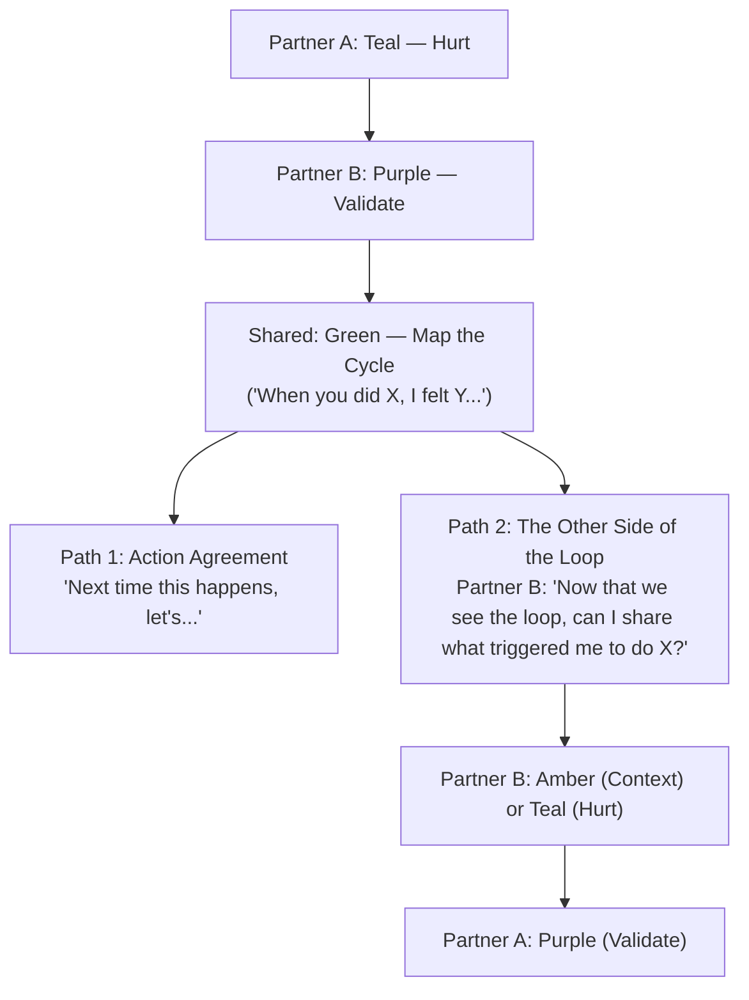

# Couples Conversation Cards (CCC)

*A physical conversational framework designed to make empathetic, resolving dialogue "right by default."*

---

## Table of Contents

1. [Why CCC? The Problem with Relationship Fights](#why-ccc-the-problem-with-relationship-fights)
2. [Core Philosophy: Poka-Yoke & The Shared Commons](#core-philosophy-poka-yoke--the-shared-commons)
3. [Table Setup: The Joint Canvas](#table-setup-the-joint-canvas)
4. [Anatomy of a Card](#anatomy-of-a-card)
5. [The 7 Card Categories & Color Language](#the-7-card-categories--color-language)
6. [How to Play: Step-by-Step Flow](#how-to-play-step-by-step-flow)
7. [Organic Transitions: Breaking the Courtroom Trap](#organic-transitions-breaking-the-courtroom-trap)
8. [The Conversational Engine: Allowed & Forbidden Moves](#the-conversational-engine-allowed--forbidden-moves)
9. [Physical Deck Formats & Printing Guide](#physical-deck-formats--printing-guide)

---

## Why CCC? The Problem with Relationship Fights

During relationship tension, couples almost always slide into an adversarial **"Courtroom Dynamic"**:

* **The Accuser & The Accused:** One partner brings a grievance (the prosecution); the other is placed on the witness stand (the defense).
* **Fixed Roles:** Even well-meaning conversational frameworks often trap one person as the "vulnerable victim" and the other as the "repentant listener," boiling inside while waiting for their turn.
* **The Defensive Hijack:** Because the listening partner fears their side will never be heard, they hijack the first pause to litigate the past, clarify their good intentions, or offer premature fixes.
* **Working Memory Overload:** Listening while emotionally activated is neurologically exhausting when counter-arguments and feelings are burning in your brain.

---

## Core Philosophy: Poka-Yoke & The Shared Commons

In high-reliability manufacturing and design, **poka-yoke** ("mistake-proofing") designs constraints so that systemic mistakes are physically prevented. CCC applies this to emotional dialogue through four core principles:

1. **The Shared Commons (No "Hands" or Personal Decks):**  
   There are no "complainer cards" and no "apology cards." All cards sit face-up in the center of the table. You and your partner are not opposing litigators across an aisle—you are two architects sitting side-by-side using a shared palette of blocks to construct mutual understanding.
2. **Poka-Yoke for Defensiveness (Sequencing Matters):**  
   The rules of the cards make conversational anti-patterns physically impossible. You cannot follow an expression of hurt directly with an explanation of your perspective. Your perspective is valid and necessary, but **sequencing matters**: hurt must be witnessed before context can be received.
3. **Cognitive Offload with Sticky Notes:**  
   Instead of interrupting or mentally rehearsing your rebuttal, write a quick 3-word phrase on a sticky note, park it on the table, and return your full presence to your partner.
4. **Relational Bridges (Organic Flow):**  
   Instead of a rigid, bureaucratic handover of power, conversations transition naturally through systemic **Cycle Mapping** and warm invitation cards.

---

## Table Setup: The Joint Canvas

Before starting, grab the card deck, a pad of sticky notes, and two pens. Arrange your table as shown below:

```
+-------------------------------------------------------------------------+
|                      [ANCHOR CARD: "US AGAINST THE PROBLEM"]            |
|                                                                         |
|                         [THE SHARED COMMONS]                            |
|       [Blue: Frame]   [Teal: Inner]   [Purple: Attune]                  |
|       [Amber: Story]  [Green: Bridge] [Coral: Break]                    |
|                                                                         |
|                            [PARKING LOT]                                |
|        (Stickies holding parked thoughts/perspectives for later)        |
|                                                                         |
|                        [CONVERSATION TRAIL]                             |
|    [Card 1] ──> [Card 2] ──> [Card 3] ──> [Card 4: Active Focus]        |
|                                                                         |
|       Partner A                                           Partner B     |
+-------------------------------------------------------------------------+
```

### What Each Area Does

* **Anchor Card (Gold):** Placed at the top of the table before speaking begins. Stays visible throughout to remind both partners: *"We are on the same team against the cycle."*
* **The Shared Commons:** Stacks of cards sorted by category color. Anyone can reach in to pull the next valid move.
* **The Parking Lot:** A dedicated spot on the table where either partner places sticky notes holding thoughts or counter-points.
* **The Conversation Trail:** Cards played in sequence. The newest card at the head of the trail is the **Active Focus**.

---

## Anatomy of a Card

Every card in the 24-card deck provides clear, visual structure to guide you in the heat of the moment:

| Card Section | What You'll See | Purpose & How to Use |
| :--- | :--- | :--- |
| **Header Band** | Category badge, Card ID (e.g., `T-01`), and position indicator | Identifies the card category at a glance and where it sits in the deck sequence. |
| **Special Badges** | *KEEP VISIBLE AT ALL TIMES* or *OVERRIDES ALL ACTIVE CARDS* | Flags cards that alter regular rules (e.g., permanent Anchor cards or emergency Circuit Breakers). |
| **Intent Callout** | Highlighted tint box at the top | Gives the clear psychological goal of the card in a single sentence. |
| **Protocols by Role** | Split steps for **Speaker / Initiator** vs. **Listener / Receiver** | Sets mutual ground rules: what the speaker expresses and how the listener holds space. |
| **Guardrails (`✕`)** | Warning box with bulleted pitfalls | Highlights the specific conversational traps and reactive habits to avoid on this step. |
| **Verbal Formulas (`❝`)**| Speech-bubble quotation examples | Pre-scripted dialogue you can read verbatim if you feel stuck, flooded, or tongue-tied. |
| **Allowed Next Moves** | Color-coded pills (e.g., `Teal`, `Purple`, `Coral`) | Shows which categories can legally follow, ensuring conversations progress safely. |

> [!TIP]
> If you feel frozen or overwhelmed, read the **Verbal Formulas** directly from the card. They are pre-scripted phrases designed to de-escalate tension and keep dialogue grounded.

---

## The 7 Card Categories & Color Language

| Color | Category | Intent | Key Dynamics & Role in Dialogue |
| :--- | :--- | :--- | :--- |
| **Gold** | **Meta / Anchor** | Shared Principles | Permanent centerpieces. Establishes unconditional safety, goodwill, and the reminder that the problem is the enemy—not your partner. |
| **Blue** | **Setting the Stage & Pacing** | Container & Safety | Opens the conversation, checks battery levels, establishes time caps, allows respectful rainchecks, and provides warm closures. |
| **Teal** | **Inner World & Bids** | Vulnerable Sharing | Expressing raw hurt, naming attachment fears, and making direct relational requests without weaponized blame. |
| **Purple** | **Attunement & Inquiry** | Active Mirroring | Listening to understand, validating emotional logic, reflecting feelings, and asking open-hearted questions. |
| **Amber** | **Perspective & Context** | Sharing Your Reality | Providing internal context, clarifying intentions, or sharing parallel triggers *after* the other partner's feelings have been held. |
| **Green** | **Collaboration & Bridges** | Co-Creating & Cycling | Mapping the shared behavioral loop, passing the floor gracefully, and agreeing on small, low-risk experiments. |
| **Coral** | **Circuit Breakers** | Nervous System Resets | Immediate timeouts for emotional flooding (heart rate > 100 bpm), calling out process-weaponization, and 60-second somatic grounding hugs. |

---

## How to Play: Step-by-Step Flow



### Step 1: Open the Space
Place the **Gold Anchor Card** in the center. Either partner can initiate using one of three entry points:
* **The Vulnerability Entry (Teal):** *"Something happened and I feel disconnected or wounded."*
* **The Curious Check-In (Purple):** *"I notice you seem quiet, tense, or distant today. I'm not here to critique; I'm curious what's on your plate."*
* **The Bid for Reassurance (Teal):** *"I don't have a complaint about you; my own anxiety or insecurity is triggered, and I need a reminder that we are good."*

### Step 2: Respect the Active Focus
Only the front-most card on the **Conversation Trail** is active. Both partners must follow its instructions simultaneously:
* The **Speaker** expresses their experience within that card's guardrails.
* The **Listener** listens within that card's posture (e.g., mirroring without defending).

### Step 3: Use the Sticky Note Parking Lot
As the listening partner, you will inevitably have thoughts, counter-memories, or different perspectives. **Do not interrupt or hold them in your head:**
1. Jot a brief 3-word trigger phrase on a sticky note (e.g., *"felt dismissed earlier"* or *"Tuesday timeline"*).
2. Stick it in the **Parking Lot** or on an **Amber** card in the Commons.
3. Immediately let go of the thought and return your full attention to listening.

### Step 4: Advance the Trail
When the current card feels complete, look at the **Allowed Next Moves** listed at the bottom of the active card.
* **Forking:** The listener can place 1 or 2 allowed cards face-up slightly to the side to offer directions.
* The speaker chooses which direction feels most resonant, placing it at the front of the trail.

> [!WARNING]
> If either partner notices signs of biological flooding (pounding pulse, clenched jaw, tunnel vision), **anyone can immediately play a Coral Circuit Breaker card**. Coral overrides all rules and initiates an automatic 20-minute pause or somatic hug.

---

## Organic Transitions: Breaking the Courtroom Trap

Relationship conversations typically collapse because partner B feels they must stay silent forever while partner A attacks them. CCC solves this with two natural bridge mechanisms:

### 1. The "Both-Sides-of-the-Loop" Bridge (Green $\rightarrow$ Amber / Teal)
In systemic therapy (EFT / Gottman), couples fights are almost never one-sided; they are an **infinite loop**:

$$\text{Partner A withdraws} \longrightarrow \text{Partner B pursues/snaps} \longrightarrow \text{Partner A retreats further}$$

Once Partner A shares their hurt (Teal) and Partner B validates it (Purple), they play a **Green (Map the Cycle)** card together:



By mapping the shared loop first, **the cycle becomes the villain**, allowing Partner B to share their reality without it sounding like an excuse.

### 2. Passing the Thread
When the initial speaker feels completely understood, they place an **"I Feel Met / Ready to Hear You"** card. This acts as a warm invitation:
> *"Thank you for listening to my experience. I feel settled and I want to understand what this was like for you. What came up on your side?"*

The listener can now pull their parked sticky notes from the table and address them in their own dedicated thread.

---

## The Conversational Engine: Allowed & Forbidden Moves

The cards enforce a healthy conversational rhythm by restricting which categories may follow:

| Current Active Card | Allowed Next Categories | Forbidden Transitions (Anti-Patterns) |
| :--- | :--- | :--- |
| **Gold (Anchor / Meta)** | *Permanent background context* | Cannot be overridden by any card |
| **Blue (Container / Framing)** | **Teal** (Inner World), **Purple** (Curious Check-In) | ✕ **Amber** (Preemptive self-defense before opening) |
| **Teal (Inner World / Bids)** | **Purple** (Attunement), **Coral** (Circuit Breaker) | ✕ **Amber** (Explaining intentions before hurt is validated) |
| **Purple (Attunement / Inquiry)**| **Purple** (Deepen), **Green** (Bridge/Cycle), **Amber** (Context — *only if invited*), **Coral** | ✕ **Green** (Jumping to practical fixes before feelings are settled) |
| **Green (Collaboration & Bridges)**| **Green** (Agreement), **Blue** (Close), **Amber / Teal** (The Other Side of the Loop) | ✕ **Teal** (Regressing to historical accusations without cycle awareness) |
| **Amber (Perspective & Context)** | **Purple** (Attunement to Context), **Coral** (Break) | ✕ **Green** (Enforcing solutions without listening to context) |
| **Coral (Circuit Breaker)** | **Coral** (Somatic Hug), **Blue** (Time-out / Raincheck) | ✕ **Amber** (Resuming heated debate while nervous systems are flooded) |

---

## Physical Deck Formats & Printing Guide

The CCC repository creates ready-to-print PDF and HTML files formatted for standard **4" x 6"** photo cards, postcards, or index cards.

### Printing Tips for Best Results
* **Cardstock:** Print on 100 lb – 130 lb cover cardstock (or 300+ gsm photo paper) with a matte or satin finish.
* **Corner Rounding:** Use a 4mm or 5mm corner punch on cut cards for a luxury feel and durable edges.
* **Table Mat:** A soft felt or leather tabletop mat makes drawing and sliding cards effortless.

## Modifications

The deck contents, design, and generation program and licensed as CC-BY-SA 4.0. See [LICENSE.txt](LICENSE.txt)

You may remix, adapt, and build upon the material as long as you credit the original authors and share your new work under the same license. Of course, contributions back to the original project are always welcome!